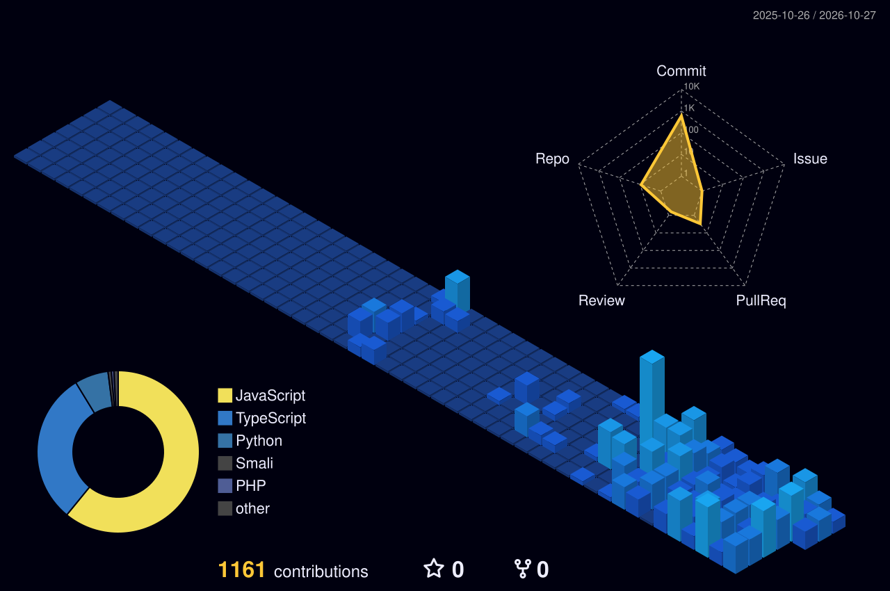

<b><code>rajashekhar@github ~ $ ./play-snake.sh</code></b>

<picture>
  <source media="(prefers-color-scheme: dark)" srcset="./github-contribution-grid-snake-dark.svg">
  <source media="(prefers-color-scheme: light)" srcset="./github-contribution-grid-snake.svg">
  
</picture>

<b><code>rajashekhar@github ~ $ whoami</code></b>

<table>
<tr>
<td valign="top"></td>
<td valign="top"></td>
</tr>
</table>

 

<b><code>rajashekhar@github ~ $ ./stack.sh</code></b>

  

 

<b><code>rajashekhar@github ~ $ ./render-skyline.sh</code></b>

 

<b><code>rajashekhar@github ~ $ ./trophy-hall.sh</code></b>

 

<b><code>rajashekhar@github ~ $ ./lofi-player.sh --stream</code></b>

 

<b><code>rajashekhar@github ~ $ ./links.sh</code></b>

<b>Full-Stack Developer · Microsoft Certified · AI Builder</b>

 

